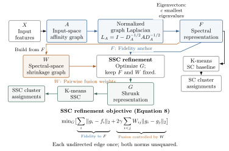

# COMP3314 Group 23: Spectral Shrunk Clustering

We study **Spectral Shrunk Clustering** (Chang et al., AAAI 2015): a convex refinement of a spectral embedding followed by K-means. This project separates reconstruction of the paper, numerical optimization, source/subset uncertainty and conditional graph-repair diagnostics.

Authors: Han Jiale, Lu Sinan, Mahatharadol Vie and Mai Sheung Ying. The University of Hong Kong, Group 23.



The input graph A determines the spectral coordinates F. A separate graph W built from F controls shrinkage into G. Matched SC clusters that same F. Convexity of the refinement does not guarantee better clustering labels.

Read the [course report](report/Group_23.pdf), [current research findings](docs/submission_refresh/research_findings.md), [issue closure](docs/submission_refresh/issue_closure.md) and [execution handover](docs/submission_refresh/final_handover.md). Detailed candidate results are in [results/subset_search](results/subset_search); the [campaign notes](docs/subset_search/README.md) explain the two statistical endpoints and coverage.

## What the results mean

The frozen historical release has 72 cells:32 measured, 24 data-blocked, 8 method-blocked and8 subset-unverified. These original statuses remain separate from new candidate measurements. Exact historical LDA-SC and several original sample manifests remain unresolved.

Current display selection minimizes the joint ACC/NMI discrepancy to the paper, using one complete configuration and all 50 declared seeds. **This is retrospective numerical matching.** It does not establish historical sample identity, label-free model selection or unbiased superiority. The earlier ACC-only selections are preserved. A native-best-of50 assignment is a separate endpoint with no across-run SD. See the [joint tables](results/submission_refresh/joint_metric_selection.csv) and [endpoint comparison](results/submission_refresh/endpoint_comparison.csv).

The candidate catalogue records all intended subsets, exact source indices, aliases and preprocessing. Different subsets rebuild A,F,W,G. Native16-by16 MSRA25 is an adapted-resolution source, with all 1,799 rows retained; it is not called recovered 32-by32 MSRA50. The pinned ClustPy LDA reference is instrumented without concealing failures. The ridge LDA-to-SC adaptation has its own name and controls.

The previous wrong-edge gate remains 0/4. New G1–G3 graph diagnostics are independent of subset winners; only their fixed gate can permit the EnSC adaptation. No additional Huber, capped-fusion or heat grids belong to this refresh. Incomplete or uncertified comparisons do not support a four-benchmark gain claim.

## Set up and obtain data

Use CPython 3.13 and the [pinned environment](environment/requirements.lock.txt):

```bash
python3 -m venv .venv
source .venv/bin/activate
python -m pip install -r environment/requirements.lock.txt
```

Keep restricted data outside the checkout. Loader priority is explicit CLI root, COMP3314_DATA_ROOT, ignored local pointer, then checkout benchmarks. Follow the [data instructions](docs/final/data_setup.md) and [new source audit](docs/submission_refresh/source_recovery.md). To retrieve the pinned native MSRA source:

```bash
python -m benchmarks.msra50.retrieve --data-root DATA_ROOT
```

Each campaign uses one durable external ARTIFACT_ROOT. Both campaigns share its resource_ledger.json: 36 additional CPU-core hours, two single-thread workers, 8 GiB aggregate RSS target, USPS repair at most 6 hours and a 2-hour finalization reserve. Creating a new root must not reset an ongoing allowance. Exact matrices, predictions, duals, checkpoints and source records are recoverable there; large/restricted arrays stay outside Git.

## Rebuild, run and validate

The frozen historical release rebuild requires no raw data, old worktrees, publisher PDF or Git history:

```bash
python -m experiments.v3_reproduction rebuild-results --release-manifest configs/final/release_manifest.json --output results/rebuilt
python -m experiments.submission_refresh rebuild --output results/joint_rebuilt
python -m experiments.v3_reproduction smoke --dataset synthetic
```

Run mandatory repairs, then the frozen subset cohort, using the same object root and ledger:

```bash
python -m experiments.submission_refresh run --config configs/submission_refresh/campaign.yaml --data-root DATA_ROOT --artifact-root ARTIFACT_ROOT --resume
python -m experiments.subset_search run --config configs/subset_search/protocol.yaml --data-root DATA_ROOT --artifact-root ARTIFACT_ROOT --resume
```

The [execution checkpoint](docs/submission_refresh/execution_status.md) identifies pending stages and resume commands. Queue reductions are frozen from label-blind cost profiles; failures and unrun combinations remain visible. Ordinary v3 module names identify experiment versions and do not depend on another Git branch.

For a small real-data check, including the MSRA loader:

```bash
python -m experiments.v3_reproduction run-experiments --config configs/submission_refresh/reproduction_adapter.yaml --data-root DATA_ROOT --datasets ORL_att92 JAFFE MSRA25_EBSA_16x16 --smoke --output local/real_smoke
```

After campaign completion, aggregate authoritative records and build the report:

```bash
python -m experiments.subset_search aggregate --artifact-root ARTIFACT_ROOT
python -m experiments.submission_refresh aggregate --artifact-root ARTIFACT_ROOT
make -C report all
```

See [source and license notes](docs/final/sources_and_licenses.md). [English transformation records](docs/submission_refresh/language_and_editorial_audit.md) distinguish original source hashes from translated bytes. Historical measurements and original text remain in Git history and the verified external backup; current rebuilds read committed current files.
