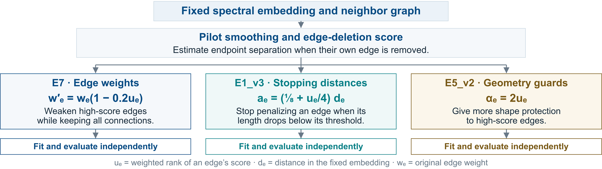

# Spectral Shrunk Clustering

An independent implementation and experimental study of **Spectral Shrunk
Clustering (SSC)** by Chang et al., [AAAI 2015](https://doi.org/10.1609/aaai.v29i1.9606).
This HKU COMP3314 Group 23 project is by Han Jiale, Lu Sinan, Mahatharadol Vie
and Mai Sheung Ying. It includes the original two-graph pipeline, baseline
reconstructions and three independently evaluated selective-contraction methods.

Several published scores can be approached, while historical input identities
and protocol choices remain partly unresolved. The controlled extension
comparisons show small local gains without a reliable general improvement.
The source/subset matches below were selected retrospectively against published
ACC/NMI targets; they are descriptive reconstructions.

## Original SSC: paper to code

1. Construct the input-space affinity **A** from the feature matrix **X**.
2. Form the normalized graph Laplacian and its spectral embedding **F**.
3. Rebuild a neighbor affinity **W** on F and hold it fixed during refinement.
4. Use iteratively reweighted least squares (IRLS) to obtain **G**.
5. Cluster G with K-means. Matched SC clusters the same F with the same rounding protocol.

The original fidelity is an **unsquared** row norm. With each undirected edge
stored once in incidence matrix C, Equation 8 is

$$P(G)=\sum_i\|g_i-f_i\|_2+2\gamma\sum_e w_e\|(CG)_e\|_2.$$

The E8 stationary system is $(S+2\gamma\widetilde L)G=SF$; the paper's printed
Equation 13 uses $(S+\gamma\widetilde L)G=SF$. Under the same symmetric edge
counting and reweighting, nominal E13 gamma corresponds to E8 gamma/2.
This coefficient mapping does not prescribe a proportional change in movement
or accuracy. The implementation solves sparse linear systems without forming
an inverse.

| Step | Implementation |
|---|---|
| Construct A and W | [`knn_affinity`](SSC_method/graph_construction.py) |
| Normalized Laplacian | [`symmetric_normalized_laplacian`](SSC_method/graph_construction.py) |
| Spectral coordinates F | [`spectral_embedding`](SSC_method/spectral_embedding.py) |
| Equation 8, S and edge reweighting | [`objective.py`](SSC_method/objective.py) |
| IRLS refinement | [`shrink_embedding`](SSC_method/optimizer.py) |
| Complete estimator | [`SpectralShrunkClustering`](SSC_method/ssc.py) |
| Hungarian ACC / geometric NMI | [`accuracy.py`](benchmarks/metrics/accuracy.py), [`nmi.py`](benchmarks/metrics/nmi.py) |

See [methods](docs/methods.md) for graph conventions, numerical floors and
baseline definitions. Estimator defaults are API defaults; each experiment
passes its own explicit settings.

## Installation

Python 3.13 is the checked environment. The package declares Python ≥3.10.
From a terminal:

```bash
git clone https://github.com/SelinaMai-SYM/COMP-3314-G23.git
cd COMP-3314-G23
python3.13 -m venv .venv
source .venv/bin/activate
python -m pip install -r environment/requirements.lock.txt
python -m pip install --no-deps -e .
```

The lock file pins the scientific dependencies used for the saved results.
CVXPY is needed only for independent small convex reference checks; TeX Live
and BibTeX are needed for [report compilation](report/README.md).

## Quick start

This complete example needs no benchmark files:

```python
import numpy as np
from sklearn.datasets import make_blobs
from SSC_method import SpectralShrunkClustering

X, _ = make_blobs(n_samples=90, centers=3, n_features=4,
                  cluster_std=0.6, random_state=7)
model = SpectralShrunkClustering(
    n_clusters=3, gamma=1.0, k=5, variant="E8", max_iter=100,
    kmeans_n_init=1, kmeans_random_state=0,
)
labels = model.fit_predict(X)
print(labels.shape, model.embedding_.shape, model.shrunk_.shape)
print(np.unique(labels))
```

The output contains 90 assignments, two 90×3 representations F/G and the
predicted cluster IDs. The same runnable example is
[`examples/ssc_blobs.py`](examples/ssc_blobs.py).

## Datasets

The experiments cover AR, JAFFE, ORL, UMIST, BinAlpha, MSRA50, YaleB and USPS.
[Data setup](docs/data.md) lists providers, download commands, local paths and
source hashes. Provider archives remain outside Git. Set `COMP3314_DATA_ROOT`
or pass `--data-root`; `local/data` is the example directory used below.

Exact AR/UMIST/BinAlpha historical membership is unresolved. Current subset
manifests preserve row IDs and ordering. YaleB source, interpolation and Y0–Y3
normalization are separate factors. The available MSRA25 EBSA matrix is native
16×16, a labelled resolution adaptation of the paper's unresolved 32×32 MSRA50
input. USPS uses the complete 9,298-row train/test concatenation in `[-1,1]`.

## Running and reproducing

**Core example**, with generated data:

```bash
python examples/ssc_blobs.py
python -m experiments.v3_reproduction smoke --dataset synthetic
```

**Table reconstruction**, using only committed scalar measurements:

```bash
python -m experiments.v3_reproduction rebuild-results \
  --release-manifest configs/final/release_manifest.json --output local/tables/historical
python -m experiments.extension_round3 rebuild \
  --release-manifest results/extension_round3/release_manifest.json \
  --output local/tables/edge-deletion --figures
python -m scripts.result_tables --output local/tables/overview.md \
  --historical-output local/tables/reconstruction.md
```

**Benchmark fitting**, after obtaining the declared data files:

```bash
python -m experiments.v3_reproduction run-experiments \
  --config configs/v3/campaign.yaml --data-root "$PWD/local/data" \
  --output "$PWD/local/ssc-runs" --resume
```

The [reproducibility guide](docs/reproducibility.md) gives baseline, subset and
extension commands, including the exact external numerical inputs needed for
extension replay. Rebuilding tables does not require those external arrays.

## Reproduction and critical findings

A fixed diagnostic uses E8, gamma 1, Y0 and the **minimum-SSE assignment from
50 RANDOM starts**. Each cell below gives ACC/NMI in percent. This single selected
assignment has no across-start SD.

<!-- BEGIN GENERATED HISTORICAL -->

| Dataset | Fixed SC ACC / NMI (%) | Fixed SSC ACC / NMI (%) |
|---|---:|---:|
| ORL | 62.25 / 83.46 | 65.25 / 84.57 |
| JAFFE | 95.31 / 94.16 | 95.31 / 94.16 |
| YaleB cropped2414 | 19.97 / 26.89 | 19.68 / 26.86 |
| USPS | 65.50 / 81.00 | 65.63 / 81.24 |

<!-- END GENERATED HISTORICAL -->

A separate joint matching analysis completed 74,436 input/configuration pairs
on 2,482 inputs: 2,480 complete 30-setting grids and two partial grids. It ranks
complete 50-start mean configurations by joint ACC/NMI discrepancy within the
stated candidate pools. AR, ORL, UMIST and BinAlpha approach both published means
within 1.37 pp. The eight selected historical IRLS outputs have no optimality-gap
certificate; five reached the iteration limit.

Initialization can matter more than incremental shrinkage: on the original ORL
records, RANDOM→greedy++ changes mean SSC ACC from **57.135% to 78.335%**.
The paper's YaleB SSC improves ACC over SC by 15.0 pp while reducing NMI by
8.8 pp. Cross-class edges carry 4.6% of ORL W weight and 70.2% of YaleB W weight;
these are post-fit label diagnostics of the refinement graph.

[Results](docs/results.md) separates fixed endpoints, baseline comparisons,
retrospective matches and extension references. The [evidence map](docs/report_evidence.md)
identifies their records, filters and generators.

## Selected extensions



*Original image from presentation slide 6.2. The branches are fitted and evaluated
independently.* A frozen ridge pilot supplies an exact edge-deletion score.
Its weighted midrank $u_e$ allocates three alternative interventions:

| Method | Intervention |
|---|---|
| E7 | Reweight edges: $w'_e=w_e(1-0.2u_e)$, retaining all connections. |
| E1_v3 | Set stopping distances $a_e=(1/8+u_e/4)d_e$; the edge term stops penalizing distances below this threshold. |
| E5_v2 | Set $\alpha_e=2u_e$ to redistribute triangle-slack guards. |

Rank mass is $w_e$ for E7/E5_v2 and $w_ed_e$ for E1_v3, where
$d_e=\|(CF)_e\|_2$. All three use quadratic fidelity. **QSSC** is the
matching quadratic base; the **plain-pilot** control uses the same intervention
without the deletion correction. The original unsquared SSC reference is a
separately fitted comparator.

The primary protocol fixes relative movement rho=0.10 and tau multiplier 1.
Each finite output has 50 one-start greedy++ Lloyd trials in both native and
anchor-generated initialization panels. The table is generated from saved
qualified paired records; differences are percentage points.

<!-- BEGIN GENERATED RESULTS -->

| Method | Qualified cohorts | Native ΔACC / ΔNMI vs QSSC | Native ΔACC / ΔNMI vs plain pilot |
|---|---:|---:|---:|
| E7 graph | 8/8 | -0.022 / +0.013 | +0.004 / -0.001 |
| E1_v3 tube | 6/8 | +0.157 / +0.358 | -0.123 / -0.068 |
| E5_v2 guard | 7/8 | +0.235 / +0.204 | +0.061 / +0.045 |

<!-- END GENERATED RESULTS -->

The masks differ, so these partial means do not rank the methods. Against plain
pilot, the common-index panel gives −0.001/−0.001 (E7), +0.014/+0.009 (E1_v3)
and +0.004/+0.003 (E5_v2). E1_v3 MSRA50/YaleB and E5_v2 MSRA50 have finite,
certified evaluations but fail the primary movement match. The MSRA50 SSC
reference is finite but uncertified, a different exclusion.

Deleted-edge AUROC improves slightly only on ORL and USPS. E5_v2 reduces
triangle slack, while also contracting both within-class and between-class
variation. On UMIST its +1.287/+1.432 pp over QSSC remains −4.475/−2.729 pp
below the separately fitted SSC reference. See the [objectives](docs/extension_round3/method_design.md),
[protocol](docs/extension_round3/experiment_protocol.md),
[complete results](results/extension_round3/summary.md) and
[development summary](docs/development_summary.md).

## Repository structure

```text
.
├── SSC_method/              # Original two-graph SSC and IRLS estimator
├── baselines/               # K-means, SC, PCA, LDA, LLC and SPLS
├── benchmarks/              # Dataset loaders, identities and metrics
├── method_extension/        # Selected refinements and numerical dependencies
├── experiments/             # Fitting, evaluation and scalar reconstruction
├── configs/                 # Frozen protocols, cohort locks and release manifests
├── results/                 # Compact measurements, trials and derived tables
├── examples/ssc_blobs.py     # Standalone generated-data example
├── docs/                    # Methods, data, protocols and evidence mapping
├── report/                  # Sections 3–7, appendix and integration instructions
├── tests/                   # Algorithm, metric and reproducibility checks
└── environment/             # Dependency versions
```

[Documentation index](docs/README.md) · [Report sections and preview](report/README.md)

The report sources contain the supplied final Sections 3–7 and appendix. The
complete PDF is exported from Overleaf after integration with its final abstract
and Sections 1–2; the repository preview contains only the supplied sections.

## Citation and license

Chang, X., Nie, F., Ma, Z., Yang, Y. and Zhou, X. (2015).
*A Convex Formulation for Spectral Shrunk Clustering*. Proceedings of AAAI, 29(1).
[Paper](https://doi.org/10.1609/aaai.v29i1.9606).

The edge-deletion formulation uses a rank-one inverse identity and a
leverage-adjustment idea discussed by [Wang et al., *Approximate Leave-One-Out
for Fast Parameter Tuning in High Dimensions*, ICML 2018](https://proceedings.mlr.press/v80/wang18m.html).
The [bibliography](report/references.bib), [CITATION.cff](CITATION.cff) and
[third-party notices](NOTICE.md) record attribution for the implementation and
baselines. Project code is [MIT licensed](LICENSE). Third-party code and datasets
retain their own terms, including the retained ClustPy BSD-3-Clause notice.
